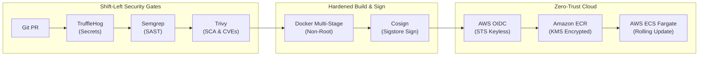

# 🎬 Video Production Blueprint: Enterprise DevSecOps CI/CD Pipeline

**Video Title:** *Building a Production DevSecOps Pipeline with GitHub Actions, AWS ECS Fargate, and Zero-Trust Security*  
**Format:** Screen-record walkthrough + on-camera talking head (or voiceover over diagram and terminal)  
**Target Length:** 8–10 Minutes  
**Primary Purpose:** Portfolio demonstration, YouTube engineering content, and proof-of-competence for senior DevSecOps / Cloud Security roles (e.g., Overflow).

---

## 🗺️ High-Level Storyboard & Timeline

```mermaid
timeline
    title Video Roadmap: DevSecOps Pipeline Walkthrough
    00:00 - 01:15 : Act 1 - The Hook & The Problem with Traditional CI/CD
    01:15 - 02:30 : Act 2 - Architecture & The 6-Stage Pipeline Map
    02:30 - 07:45 : Act 3 - Software Package Deep Dive & Live Demo
                  : AWS OIDC Keyless Auth
                  : TruffleHog Secret Scanning
                  : Semgrep SAST
                  : Trivy SCA & Container Scanning
                  : Cosign Keyless Image Signing
                  : AWS ECS Fargate Zero-Downtime Deploy
    07:45 - 08:45 : Act 4 - SOC 2 & PCI-DSS Compliance Mapping
    08:45 - 09:30 : Act 5 - Conclusion & GitHub Repository Showcase
```

---

## 🎥 Scene-by-Scene Shot List & Script

### Act 1: The Hook & The Reality of DevOps (0:00 – 1:15)
* **Visual:** On-camera or clean title card transitioning to a mock security breach diagram.
* **On-Screen Text:** *"Most CI/CD pipelines are an open invitation for a security breach."*
* **Voiceover / Talking Points:**
  > "In most startups, CI/CD is treated as an afterthought. You have long-lived AWS root or IAM access keys sitting in GitHub Secrets. You have Dockerfiles running as root. And code gets merged into production without any automated vulnerability scanning until a security audit or a penetration test flags it.
  > 
  > Today, we're building the exact DevSecOps architecture required for high-growth fintechs, SOC 2 Type II, and PCI-DSS compliance. We're going to walk through an end-to-end GitHub Actions pipeline that deploys a microservice to **AWS ECS Fargate** with zero static credentials, automated secret detection, SAST, dependency auditing, container vulnerability scanning, and cryptographic image signing."

---

### Act 2: Architecture Overview & The Shift-Left Model (1:15 – 2:30)
* **Visual:** Full-screen animated Mermaid diagram of the 6-stage pipeline.
* **On-Screen Display:** Highlight each stage as it's introduced.



* **Voiceover / Talking Points:**
  > "Instead of inspecting software after it's in production, we practice **Shift-Left Security**. Every pull request must pass four automated security gates before it can ever be merged. If a developer accidentally commits an API key or introduces a critical vulnerability, the pipeline breaks immediately at the pull request level."

---

### Act 3: Package-by-Package Deep Dive & Live Demo (2:30 – 7:45)

#### Package 1: AWS IAM OpenID Connect (OIDC) — Eliminating Static Credentials (2:30 – 3:30)
* **Visual:** Split screen showing `terraform/oidc.tf` and GitHub repository secret settings.
* **Key Concept:** Why static `AWS_ACCESS_KEY_ID` and `AWS_SECRET_ACCESS_KEY` are dangerous.
* **What to Show:**
  1. Highlight `aws_iam_openid_connect_provider` pointed at `token.actions.githubusercontent.com`.
  2. Point out the trust condition scoped to `repo:your-username/devsecops-ecs-pipeline:*`.
* **Voiceover:**
  > "First, we eliminate all static AWS credentials. Traditional setups store long-lived IAM keys in GitHub Secrets. If an attacker gains read access to the repo or compromises an action runner, your AWS account is toast. 
  > With OIDC, GitHub Actions requests a short-lived JSON Web Token from GitHub. AWS verifies the token signature and grants a temporary 15-minute STS session. Zero keys stored in GitHub."

#### Package 2: TruffleHog — Automated Secret Scanning (3:30 – 4:15)
* **Visual:** VS Code terminal showing a simulated git commit.
* **What to Show:**
  1. Triggering the GitHub Action.
  2. Show TruffleHog inspecting the commit history and verifying entropy against public credential patterns.
* **Voiceover:**
  > "Stage 1 runs TruffleHog. It scans the git diff for exposed private keys, database connection strings, and API tokens. What sets TruffleHog apart is verification—it doesn't just look for strings; it verifies whether the credential is active, eliminating false positives."

#### Package 3: Semgrep — Static Application Security Testing (SAST) (4:15 – 5:00)
* **Visual:** GitHub Actions log showing Semgrep output and `semgrep.sarif` uploaded to the GitHub Security tab.
* **What to Show:**
  1. The Semgrep rule-packs: `p/owasp-top-ten`, `p/cwe-top-25`, and `p/security-audit`.
  2. Show how it parses the AST (Abstract Syntax Tree) to catch vulnerabilities without running the application.
* **Voiceover:**
  > "Stage 2 runs Semgrep for SAST. Unlike legacy scanners that take hours, Semgrep runs in seconds directly in the GitHub runner. It inspects our Python FastAPI code against OWASP Top 10 rule-packs, flagging injection flaws, insecure headers, and broken access controls."

#### Package 4: Trivy — Software Composition Analysis (SCA) & Container CVEs (5:00 – 6:00)
* **Visual:** Code comparison of `Dockerfile` (Multi-stage builder vs. runtime) followed by Trivy's vulnerability table.
* **What to Show:**
  1. Show how Trivy first scans `app/requirements.txt` for vulnerable packages.
  2. Show how Trivy scans the compiled Docker image for OS-level vulnerabilities (e.g., OpenSSL, glibc).
  3. Show the `USER 10001:10001` non-root directive in the Dockerfile.
* **Voiceover:**
  > "Stage 3 and 4 handle dependency and container scanning using Trivy. In the Dockerfile, we follow CIS benchmarks: multi-stage builds so compilers never touch production, and running as an unprivileged user (UID 10001). Trivy scans every OS package and Python library against the National Vulnerability Database."

#### Package 5: Cosign (Sigstore) — Cryptographic Container Signing (6:00 – 6:45)
* **Visual:** Terminal showing `cosign verify` and the signature metadata uploaded to ECR.
* **What to Show:**
  1. The step `cosign sign ${ECR_REGISTRY}/${ECR_REPOSITORY}:${IMAGE_TAG}`.
  2. Explain the concept of Software Supply Chain Security (SLSA).
* **Voiceover:**
  > "Before deploying, we cryptographically sign the container image using Cosign from the Sigstore project. Using the GitHub Actions OIDC identity, Cosign produces a keyless cryptographic signature. If someone were to tamper with the image in ECR, the signature would fail."

#### Package 6: AWS ECS Fargate & Automated Rollback (6:45 – 7:45)
* **Visual:** AWS ECS Management Console showing task deployment and CloudWatch logs.
* **What to Show:**
  1. GitHub Actions registering the new task definition.
  2. ECS Fargate launching the new container alongside the old one.
  3. ALB target health check probe `/health` passing before draining the old container.
* **Voiceover:**
  > "Finally, the image is deployed to AWS ECS Fargate. We use a rolling zero-downtime deployment. ECS launches the new task, verifies the `/health` endpoint through the Application Load Balancer, and only drains the old task once the new container is healthy. If the health check fails, CloudWatch triggers an automated rollback."

---

### Act 4: SOC 2 Type II Compliance Mapping (7:45 – 8:45)
* **Visual:** Slide showcasing the SOC 2 Trust Services Criteria mapping table.
* **On-Screen Graphic:**

| SOC 2 Criteria | Tool / Implementation |
| :--- | :--- |
| **CC6.1 (Logical Access)** | AWS OIDC Keyless Role Assumption |
| **CC6.6 (Encryption at Rest)** | Amazon ECR KMS Customer Managed Keys |
| **CC7.1 (Vulnerability Mgmt)** | Automated Trivy & Semgrep Scanning |
| **CC7.2 (Audit Logging)** | CloudWatch Container Insights (365-day retention) |
| **CC8.1 (Change Management)** | GitHub Branch Protection (2 Approvals + Green CI) |

* **Voiceover:**
  > "When an auditor from an accounting firm reviews your company for SOC 2 Type II, they want to see evidence for every single control. With this setup, your entire compliance trail is automated in code. You have auditable git history, cryptographic image signatures, and zero static keys."

---

### Act 5: Conclusion & Resources (8:45 – 9:30)
* **Visual:** On-camera closing with GitHub repository displayed on the side.
* **Voiceover:**
  > "This is how modern engineering organizations scale safely. Everything we covered today—the Terraform infrastructure, the multi-stage Dockerfile, and the full GitHub Actions workflow—is available on GitHub in the description below. If you're building out cloud platforms or preparing for DevSecOps interviews, fork the repo and test it out yourself."

---

## 🛠️ Screen-Recording Checklist

1. [ ] **VS Code Theme:** Clean, high-contrast dark theme (e.g., GitHub Dark Default or One Dark Pro).
2. [ ] **Font Size:** Zoom in to at least 16–18pt so code is easily readable on mobile screens.
3. [ ] **Browser Windows Pre-opened:**
   * GitHub Actions Workflow run tab (with green checkmarks).
   * GitHub Advanced Security tab (showing SARIF analysis).
   * AWS Console (ECS Cluster & ECR Repository).
4. [ ] **Terminal Setup:** Clear terminal history and run `git status` to ensure a clean working tree.
